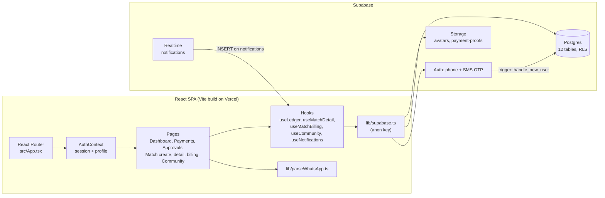

<p align="center"></p>

<p align="center">
  <a href="https://github.com/abhinav-adtechs/one-love-football/actions/workflows/ci.yml"></a>
  
  
  
  <a href="LICENSE"></a>
  <a href="https://github.com/abhinav-adtechs/one-love-football/commits/main"></a>
  <a href="CONTRIBUTING.md"></a>
</p>

<p align="center"><b>Run a pickup football group from your phone: paste the WhatsApp sign-up list,<br>split the turf bill, collect on the touchline, and keep every player's balance straight.</b></p>

<p align="center">
  <a href="#features">Features</a> ·
  <a href="#quick-start">Quick start</a> ·
  <a href="#architecture">Architecture</a> ·
  <a href="#docs">Docs</a> ·
  <a href="#roadmap">Roadmap</a> ·
  <a href="#contributing">Contributing</a>
</p>

> [!NOTE]
> **Early days.** One Love Football was built in March 2026 for a pickup group playing on turfs in Bengaluru. The core loop (sign in, create a match from WhatsApp, bill it, collect, approve payments) works end to end. Some tables in the schema, like game stats and venues, don't have screens yet: see the [roadmap](#roadmap).

## Why One Love Football?

Pickup football runs on a WhatsApp group. Someone posts the date, time and turf, people reply with their names, guests turn up as "+1", the host books and pays the turf, and then spends the week chasing ₹300 here and ₹250 there across Google Pay screenshots and cash. One Love Football turns that message into a match, works out each player's share of the turf, and keeps a running balance per player, with payment screenshots a host approves, so nobody has to keep a spreadsheet of who owes what.

## Features

<table>
<tr>
<td width="50%" valign="top">

### 📋 WhatsApp roster import

Paste the match message. The parser pulls out the title, date (`22nd March`, `22/3`, `this Sunday`), time (`6:30 PM`, `18:30`), venue, and the numbered player list with phone numbers, **paid** markers (✅, "paid", "done"), and guests and `+1`s.

</td>
<td width="50%" valign="top">

### 🔗 Matched to your community

Each parsed phone number is normalised to a 10-digit Indian mobile and matched to a member's profile, so regulars land on the roster as themselves and everyone else as a guest. Review the list, edit, untick or add players before you save.

</td>
</tr>
<tr>
<td valign="top">

### ⚽ Any format

5v5 to 11v11, plus three-team formats (6v6v6 to 9v9v9). Picking a format sets the player count; enter the total turf cost and the **fee per player** is split for you, rounded up.

</td>
<td valign="top">

### 🧮 Match billing

Turf booking cost, additional charges (with a reason, like bibs or water) and a round-off adjustment give a **per-player share** and a total to collect. Mark players to pay and each gets a due amount and a debit on their ledger.

</td>
</tr>
<tr>
<td valign="top">

### 💵 Touchline collection

On the match page, tap a player to mark their share **collected** (or enter a custom amount), with undo. Group players into teams, add a whole team at once, and mark a team paid in one go. Add more players later, matched to profiles by phone.

</td>
<td valign="top">

### 🏟️ Turf payments

Record what was paid to the turf, by whom and how, and see paid-so-far against the booking cost, the balance left and a payment history.

</td>
</tr>
<tr>
<td valign="top">

### 💰 A balance for every player

Each player's balance is the sum of their **approved** ledger entries, kept in paise so the maths stays exact. Top up with Google Pay, PhonePe, UPI, bank transfer, cash or other, with a screenshot as proof (required for everything but cash). Below −₹300, the app says **Clear dues to join matches**.

</td>
<td valign="top">

### ✅ Payment approvals

Hosts and admins get a queue of pending payments with the proof attached: **Approve** or **Reject**, and the player is notified. Cash handed over in person can be recorded directly.

</td>
</tr>
<tr>
<td valign="top">

### 🔔 Live notifications

A bell with an unread count, mark-one or mark-all read, and new notifications pushed in through Supabase Realtime.

</td>
<td valign="top">

### 👥 Community directory

Search members by name or phone. Each card shows jersey number, phone, role, positions, and matches played, goals, assists and Man of the Match awards from recorded stats.

</td>
</tr>
<tr>
<td valign="top">

### 📱 Phone-number sign-in

Sign in with a +91 mobile number and a 6-digit SMS code (with a 60-second resend timer). First time in, set your display name, jersey number (1–99) and preferred positions.

</td>
<td valign="top">

### 🛡️ Roles and row-level security

**Players**, **hosts** and **admins** (an admin can do everything a host can). The UI gates host screens, and Postgres row-level security on every table decides what each role can read and write. Payment proofs live in a private storage bucket.

</td>
</tr>
</table>

## Tech stack

**Frontend** &nbsp;


**Backend** &nbsp;


**Hosting and CI** &nbsp;


## Architecture

A single-page React app talks straight to Supabase with the public anon key; there is no server of its own. Every rule about who can see or change what lives in Postgres row-level security, and Vercel serves the static build with one rewrite so client-side routes work on refresh.



More detail (routes, data model, the money flow, the parser) is in [`docs/ARCHITECTURE.md`](docs/ARCHITECTURE.md).

## Quick start

**Prerequisites:** Node.js 18 or newer (CI uses 22), npm, and a [Supabase](https://supabase.com) project.

```sh
git clone https://github.com/abhinav-adtechs/one-love-football.git
cd one-love-football
npm install
cp .env.example .env            # then set VITE_SUPABASE_URL and VITE_SUPABASE_ANON_KEY
npm run dev                     # http://localhost:5173
```

> [!IMPORTANT]
> The app needs a Supabase project to start: without `VITE_SUPABASE_URL` and `VITE_SUPABASE_ANON_KEY`, `src/lib/supabase.ts` throws on load and the page stays blank.

| Script            | What it does                       |
| ----------------- | ---------------------------------- |
| `npm run dev`     | Vite dev server on port 5173       |
| `npm run build`   | Production build into `dist/`      |
| `npm run preview` | Serve the production build locally |

### Set up Supabase

1. **Schema.** In the SQL editor, run every file in [`supabase/migrations/`](supabase/migrations) in order, `001` to `017`. (`supabase/schema.sql` is `001` to `014` in one file; if you use it, run `015`, `016` and `017` after it.)
2. **Phone sign-in.** Authentication → Providers → **Phone**: turn it on and connect an SMS provider that Supabase supports. Sign-in sends a 6-digit code to a `+91` number.
3. **Live notifications.** Add the `notifications` table to Realtime (Database → Publications → `supabase_realtime`). Without it the bell still works, but only updates on reload.
4. **Your first admin.** Sign in once so your profile is created, then in the SQL editor:

   ```sql
   update profiles set role = 'admin' where phone = '91XXXXXXXXXX';
   ```

   Supabase stores phone numbers with the country code and no `+`. Promote hosts the same way with `role = 'host'`.

Full walkthrough, including deploying to Vercel, in [`docs/SETUP.md`](docs/SETUP.md).

## Configuration

| Variable                 | Required | What it does                                                                      |
| ------------------------ | -------- | --------------------------------------------------------------------------------- |
| `VITE_SUPABASE_URL`      | Yes      | Your Supabase project URL (Project settings → API)                                |
| `VITE_SUPABASE_ANON_KEY` | Yes      | The project's `anon` key. Public by design; row-level security protects the data. |

`.env.example` also lists server-only values (`ONE_LOVE_SUPABASE_SERVICE_ROLE_KEY`, `ONE_LOVE_SUPABASE_JWT_SECRET`, `ONE_LOVE_POSTGRES_URL`, `ONE_LOVE_POSTGRES_URL_NON_POOLING`) for migrations or future Edge Functions. The app doesn't read them.

> [!WARNING]
> `vite.config.ts` sets `envPrefix` to `VITE_`, `NEXT_PUBLIC_` and `ONE_LOVE_`, so any variable with those prefixes **can** be read by client code and end up in the bundle if referenced. Today only the two `VITE_` values are used. Keep service-role keys and database URLs out of the build environment, or drop `ONE_LOVE_` from `envPrefix`.

## Project structure

```text
one-love-football/
├── index.html                 Vite entry, mounts #app
├── vercel.json                SPA rewrite: every path → index.html
├── vite.config.ts             React plugin, dev port 5173, env prefixes
├── src/
│   ├── main.tsx               BrowserRouter + AuthProvider
│   ├── App.tsx                routes (public: /login, /verify; the rest behind ProtectedRoute)
│   ├── context/AuthContext.tsx   Supabase session, profile, OTP sign-in
│   ├── pages/                 Login, OtpVerify, ProfileSetup, Dashboard, Payments, PaymentApproval,
│   │                          MatchCreate, MatchDetail, MatchBilling, Community
│   ├── components/            Layout (header + bottom nav), RoleGate, ProtectedRoute, LedgerTable,
│   │                          PaymentForm, PaymentProofUpload, BalanceBadge, NotificationBell
│   ├── hooks/                 useLedger, useMatchDetail, useMatchBilling, useCommunity,
│   │                          useNotifications, useProfile, useAuth
│   ├── lib/
│   │   ├── parseWhatsApp.ts   WhatsApp match message → title, date, time, venue, players
│   │   ├── currency.ts        paise ↔ rupees, ₹ formatting (en-IN)
│   │   └── supabase.ts        the Supabase client
│   ├── types.ts               row types and enums mirroring the schema
│   └── index.css              the whole stylesheet
└── supabase/
    ├── migrations/            001–017: enums, tables, indexes, RLS, storage buckets
    └── schema.sql             001–014 in one file
```

## Docs

| Doc                                            | What's in it                                                                                                               |
| ---------------------------------------------- | -------------------------------------------------------------------------------------------------------------------------- |
| [`docs/ARCHITECTURE.md`](docs/ARCHITECTURE.md) | Routes and roles, data model, how money moves through billing, the ledger and approvals, and how the WhatsApp parser works |
| [`docs/SETUP.md`](docs/SETUP.md)               | Supabase project, migrations, phone auth, Realtime, the first admin, and deploying to Vercel                               |
| [`CONTRIBUTING.md`](CONTRIBUTING.md)           | Dev setup, conventions and the PR checklist                                                                                |
| [`CHANGELOG.md`](CHANGELOG.md)                 | What changed, release by release                                                                                           |

## Roadmap

- [ ] Fix: **+ Add** on the New Match screen adds a `+1` row instead of a player
- [ ] Fix: payment-proof screenshots on the approvals page (private bucket needs signed URLs)
- [ ] Fix: settle a player's match dues when their payment is approved
- [ ] Make `tsc --noEmit` pass and type-check in CI
- [ ] Unit tests for the WhatsApp parser, and fix `+1` attribution
- [ ] Record games and player stats (goals, assists, Man of the Match)
- [ ] Pick the turf from the `venues` table instead of a hard-coded list
- [ ] Let players join an open match themselves

## Contributing

Contributions are welcome, especially from people who organise games. Read [`CONTRIBUTING.md`](CONTRIBUTING.md) for setup, conventions and the PR checklist. Please follow the [Code of Conduct](https://github.com/abhinav-adtechs/.github/blob/main/CODE_OF_CONDUCT.md), and report security issues privately as described in the [security policy](https://github.com/abhinav-adtechs/.github/blob/main/SECURITY.md).

## License

[MIT](LICENSE) © 2026 Abhinav Das

## Star history

<a href="https://star-history.com/#abhinav-adtechs/one-love-football&Date"></a>

<br>

<p align="center">Built by <a href="https://github.com/abhinav-adtechs">Abhinav Das</a></p>
<p align="center">If this project helped you, consider giving it a ⭐</p>
