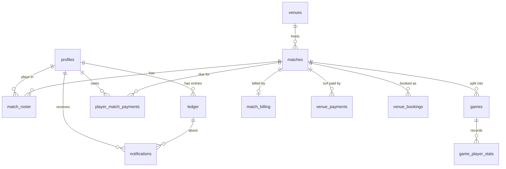
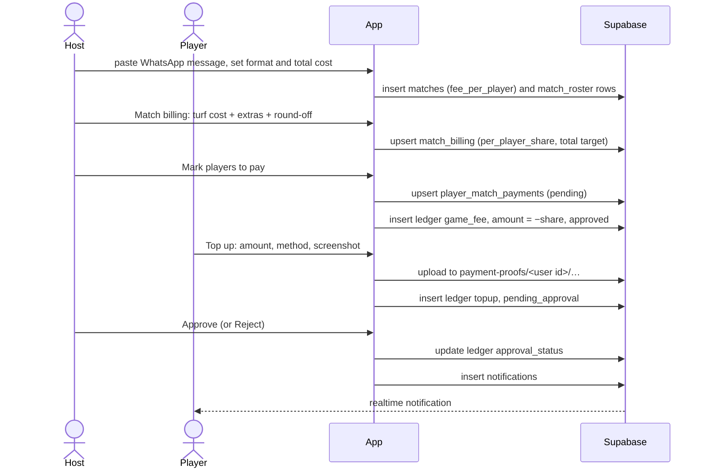

# Architecture

How One Love Football is put together: a React single-page app on top of Supabase, with no server code of its own. This page covers the routes and roles, the data model, how money moves, and how the WhatsApp parser reads a message. Setup is in [`SETUP.md`](SETUP.md).

- [Overview](#overview)
- [Routes and roles](#routes-and-roles)
- [Data model](#data-model)
- [How money moves](#how-money-moves)
- [The WhatsApp parser](#the-whatsapp-parser)
- [Auth and profiles](#auth-and-profiles)
- [Security model](#security-model)
- [Known gaps](#known-gaps)

## Overview

```text
src/main.tsx ── BrowserRouter ── AuthProvider ── App (routes)
                                     │
                       pages/*  ──  hooks/*  ──  lib/supabase.ts ──▶ Supabase (Auth, Postgres, Storage, Realtime)
                          │
                    lib/parseWhatsApp.ts, lib/currency.ts
```

- **Pages** (`src/pages/`) render a screen and call hooks or the Supabase client directly.
- **Hooks** (`src/hooks/`) own the data for a screen: `useLedger` (a player's entries, balance and top-ups), `useMatchDetail` (match, roster, billing, turf payments, cash collection), `useMatchBilling` (billing and marking players to pay), `useCommunity` (members with aggregated stats), `useNotifications` (list, unread count, realtime inserts), `useProfile`.
- **`AuthContext`** (`src/context/AuthContext.tsx`) holds the Supabase session and the signed-in user's `profiles` row. It subscribes to `onAuthStateChange` and fetches the profile outside the auth callback to avoid a deadlock.
- **Money is integers in paise** throughout (`lib/currency.ts`: `rupeesToPaise`, `formatPaise` with `en-IN` grouping).
- **Styles** are one stylesheet, `src/index.css`, mobile-first with a bottom navigation bar.
- **Hosting:** `vite build` produces static files in `dist/`; `vercel.json` rewrites every path to `index.html` so client-side routes survive a refresh.

## Routes and roles

| Path                        | Page                  | Who                                                                    |
| --------------------------- | --------------------- | ---------------------------------------------------------------------- |
| `/login`                    | `LoginPage`           | Anyone. +91 number → SMS code                                          |
| `/verify`                   | `OtpVerifyPage`       | Anyone with a pending code                                             |
| `/profile-setup`            | `ProfileSetupPage`    | Signed in. Forced while the display name is still the default `Player` |
| `/`                         | `DashboardPage`       | Signed in. Hosts also see pending approvals and outstanding dues       |
| `/payments`                 | `PaymentsPage`        | Signed in. Balance, top-up form, history                               |
| `/payments/approve`         | `PaymentApprovalPage` | Host, admin                                                            |
| `/matches/new`              | `MatchCreatePage`     | Host, admin                                                            |
| `/matches/:matchId`         | `MatchDetailPage`     | Signed in. Collection and turf actions for host, admin                 |
| `/matches/:matchId/billing` | `MatchBillingPage`    | Host, admin                                                            |
| `/community`                | `CommunityPage`       | Signed in                                                              |

`ProtectedRoute` sends anyone without a session to `/login`. `RoleGate` wraps host screens; an admin passes any gate a host passes. These are UI conveniences: what a role can actually read or write is decided by row-level security in the database.

## Data model

Migrations live in [`supabase/migrations/`](../supabase/migrations) and are applied in order (`001`–`018`). TypeScript mirrors of the rows and enums are in `src/types.ts`.



| Table                              | What it holds                                                                                                                                                                                     |
| ---------------------------------- | ------------------------------------------------------------------------------------------------------------------------------------------------------------------------------------------------- |
| `profiles`                         | One per signed-up phone: display name, jersey number, role (`player`, `host`, `admin`), preferred positions, ban flag. Created by a trigger on `auth.users`.                                      |
| `venues`                           | Turfs: address, cost per hour, surface, supported formats, contact.                                                                                                                               |
| `matches`                          | A match: type, status, format, date and times, venue, player limits, fee per player and late/no-show/extension fees (paise), notes.                                                               |
| `games`                            | Games within a match: team names and scores, extensions.                                                                                                                                          |
| `match_roster`                     | Who's in: a profile or a guest (name, phone), source (`community`, `playo`, `external`, `guest_plus_one`), status, team, attendance, and `amount_collected` / `paid_at` for touchline cash (016). |
| `match_billing`                    | Turf booking cost, additional charges and note, round-off, per-player share, total to collect.                                                                                                    |
| `player_match_payments`            | Per player per match: amount due, amount paid, status. Unique on `(match_id, profile_id)`.                                                                                                        |
| `ledger`                           | Append-only money log per player: entry type (`game_fee`, `topup`, `refund`, `adjustment`…), signed amount, method, proof path, approval status.                                                  |
| `venue_payments`, `venue_bookings` | Money paid to the turf, and booking records.                                                                                                                                                      |
| `game_player_stats`                | Goals, assists, own goals, clean sheet, Man of the Match, rating, per player per game.                                                                                                            |
| `notifications`                    | Per-player messages with a read flag.                                                                                                                                                             |

Storage buckets (`014`): `avatars` (public read) and `payment-proofs` (private; each player uploads into a folder named after their user id).

## How money moves



- **Balance** (`useLedger`) is the sum of a player's **approved** ledger entries. Debits are negative, top-ups positive. Below −₹300 (`BLOCK_THRESHOLD_PAISE`) the app flags the player with **Clear dues to join matches**.
- **Cash on the touchline** is tracked on the roster (`match_roster.amount_collected`, `paid_at`), separately from the ledger, so a host can tick people off during the game. Cash meant to credit a player's balance is recorded on the approvals page, which writes an approved `topup`.
- **Turf payments** (`venue_payments`) are compared with `match_billing.turf_booking_cost` to show paid-so-far and the balance left.

## The WhatsApp parser

`src/lib/parseWhatsApp.ts` is a pure function, `parseWhatsApp(text)`, that turns a match message into `{ title, date, time, venueName, players }`.

1. **Header and list.** Lines are trimmed; the first line that looks like `1. Name`, `2) Name` or `3 - Name` starts the player list. Everything before it (or the first four lines if there's no list) is the header.
2. **Title** is the first header line with football emoji and separators stripped, or `Football Match`.
3. **Date** tries, in order: `22nd March [2026]`, `22/3[/2026]` (also `-`, `.`), then a day name (`this Sunday`, `coming Monday`), resolved to the next such day.
4. **Time** tries `6:30 PM` / `18:30`, then `6 PM`.
5. **Venue** is a line starting `Venue:`, `At:`, `Ground:`, `Turf:`, `Location:` or `Place:`, else the first short line mentioning turf, ground, arena, court, sports, stadium or futsal.
6. **Each player line** is checked for a guest marker (`guest`, `g`, `external`, `+1`, `plus one`), an Indian mobile number (`+91`, `91`, `0` or bare, normalised to 10 digits starting 6–9), and a paid marker (✅ ✓ ☑ ✔ 💰, or `paid`, `done`, `cleared`, `confirmed`, `received`; `pending`, `due`, `unpaid` mean unpaid). What's left is the name.
7. **+1s** are meant to be attributed to the last regular player above them (`plusOneOf`). Today that only happens for lines that start with `plus one`: the `+1` check runs against the whole line, number included, so `3. +1` comes through as an unattributed guest. The parser-tests item on the [roadmap](../README.md#roadmap) covers the fix.

`MatchCreatePage` then matches each phone against `profiles.phone` by its last 10 digits (`phonesMatch`), so known players join as themselves (`source = community`) and the rest as guests (`external`, or `guest_plus_one` for +1s).

## Auth and profiles

- Sign-in is Supabase phone auth: `signInWithOtp({ phone: '+91…' })`, then `verifyOtp({ type: 'sms' })`.
- A trigger, `handle_new_user` (`002`), creates a `profiles` row for every new auth user with the phone and a display name of `Player`.
- While the display name is still `Player`, `ProtectedRoute` sends the user to `/profile-setup`.
- Roles start as `player`. Hosts and admins are promoted in SQL (see [`SETUP.md`](SETUP.md#5-make-yourself-an-admin)).

## Security model

- The browser only ever holds the **anon key**. Every table has row-level security enabled (`013`, `015`).
- `is_host_or_admin()` (a `SECURITY DEFINER` SQL function) backs the host-only policies: creating and updating matches, billing, payment records, venue payments and bookings, stats, notifications, and approving ledger entries.
- Players can read their own ledger entries, payments and notifications; hosts and admins can read everyone's.
- `payment-proofs` is private: a player can upload only into their own folder and read their own files; hosts and admins can read all of them.
- The ledger has no delete policy; corrections are meant to be new `adjustment` entries.

## Known gaps

These are tracked on the [roadmap](../README.md#roadmap):

- Nothing marks `player_match_payments` as paid yet, so a host's **Outstanding dues** only grows.
- The approvals page builds proof links with `getPublicUrl`, which doesn't work for the private `payment-proofs` bucket.
- `games`, `game_player_stats`, `venues` and `venue_bookings` have tables and policies but no screens; the turf is picked from a hard-coded list and saved into `matches.notes`.
- A `3. +1` line isn't attributed to the player above it (see [the parser](#the-whatsapp-parser)), and **+ Add** on the New Match screen adds a row that's treated as a `+1`.
- `tsc --noEmit` reports a handful of errors (`vite build` doesn't type-check), so CI runs the build only.
